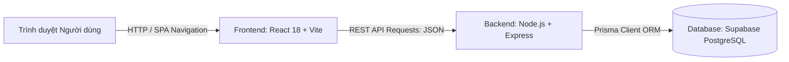

# TECHNICAL STACK & KIẾN TRÚC HỆ THỐNG

Dự án **Restaurant Management System** được thiết kế theo mô hình kiến trúc hiện đại tách biệt hoàn toàn giữa **Backend (REST API)** và **Frontend (React Single Page Application - SPA)**.

---

## 1. TỔNG QUAN CÔNG NGHỆ (TECH STACK OVERVIEW)



| Tầng (Layer) | Công nghệ chính | Phiên bản | Vai trò & Mục đích |
| :--- | :--- | :--- | :--- |
| **Frontend** | React | `^18.3.1` | Xây dựng giao diện người dùng theo kiến trúc component, quản lý trạng thái UI |
| **Frontend Routing** | React Router DOM | `^6.27.0` | Quản lý định tuyến SPA phía client, HTML5 History API, không reload document |
| **Build Tool / Bundler** | Vite | `^5.4.10` | Dev server khởi động siêu tốc (HMR), bundle tối ưu hóa dung lượng khi build production |
| **Backend Runtime** | Node.js | `>= 20` | Môi trường thực thi JavaScript trên máy chủ |
| **Backend Framework** | Express.js | `^4.21.1` | Xây dựng REST API web server, xử lý routing, middleware, CORS và JSON payload |
| **Database ORM** | Prisma ORM | `^5.21.1` | Quản lý schema database, quan hệ models (1-N, N-N), query builder an toàn tránh SQL Injection |
| **Database** | PostgreSQL | `v15+` | Hệ quản trị cơ sở dữ liệu quan hệ (được host trên đám mây Supabase) |
| **Automated Testing** | Node Test Runner & Supertest | `Node native` & `^7.0.0` | Bộ kiểm thử tự động toàn diện kiểm tra CORS, Response Shape, HTTP Status và Lỗi nghiệp vụ |
| **Environment Config** | Dotenv | `^16.4.5` | Quản lý biến môi trường bảo mật (`.env`) |

---

## 2. KIẾN TRÚC CHI TIẾT TỪNG PHẦN

### A. Frontend (Single Page Application - SPA)
- **Thư mục:** [`web/`](file:///D:/III_HK1/Web2/Block6/web)
- **Cổng chạy mặc định:** `http://localhost:5173`
- **Các thành phần cốt lõi:**
  1. **React Router v6:** 
     - Quản lý các view công khai: Thực đơn (`/dishes`), Chi tiết món ăn (`/dishes/:id`).
     - Quản lý các view quản trị: Quản lý món ăn (`/admin/dishes`), Đầu bếp (`/admin/chefs`), Kho nguyên liệu (`/admin/ingredients`).
     - SPA Fallback: Hỗ trợ F5 reload trực tiếp tại bất kỳ URL nào mà không bị lỗi 404 máy chủ.
  2. **API Client tập trung ([`web/src/apiClient.js`](file:///D:/III_HK1/Web2/Block6/web/src/apiClient.js)):**
     - Nơi duy nhất định nghĩa URL gốc `http://localhost:3000/api`.
     - Bóc tách chuẩn **3 tầng lỗi**:
       - *Tầng 1 (Network Error):* Mất kết nối hoặc bị chặn CORS.
       - *Tầng 2 (HTTP Error):* Lỗi kỹ thuật hạ tầng (HTTP 404 route không tồn tại, HTTP 500 lỗi máy chủ).
       - *Tầng 3 (Business Error):* Lỗi nghiệp vụ khi máy chủ phản hồi `ok: false` (`NOT_FOUND`, `VALIDATION_FAILED`).
  3. **Xử lý trạng thái UI đa dạng ([`StateViews.jsx`](file:///D:/III_HK1/Web2/Block6/web/src/components/StateViews.jsx)):**
     - `loading`: Spinner trang nhã khi đang nạp dữ liệu.
     - `ok`: Hiển thị dữ liệu danh sách/chi tiết.
     - `empty`: Hiển thị thông báo khi danh mục rỗng kèm nút điều hướng.
     - `notFound`: Giao diện thông báo rõ ràng "Không tìm thấy món ăn/nguyên liệu/đầu bếp", không để lộ mã lỗi kỹ thuật 404 lên giao diện người dùng.
     - `error`: Banner cảnh báo kèm nút **"Thử lại" (Retry)**.

---

### B. Backend (REST API Server)
- **Thư mục:** [`api/`](file:///D:/III_HK1/Web2/Block6/api)
- **Cổng chạy mặc định:** `http://localhost:3000`
- **Cấu trúc Response Shape chuẩn:**
  - Khi thành công:
    ```json
    {
      "ok": true,
      "data": [...] // Mảng hoặc đối tượng chi tiết
    }
    ```
  - Khi lỗi nghiệp vụ (HTTP Status 200):
    ```json
    {
      "ok": false,
      "error": {
        "code": "NOT_FOUND" | "VALIDATION_FAILED",
        "message": "Thông điệp lỗi mô tả cụ thể",
        "fields": { "fieldName": "Mô tả lỗi vi phạm của trường" }
      }
    }
    ```
  - Khi lỗi kỹ thuật (Route không tồn tại hoặc lỗi máy chủ nội bộ):
    - Sai URL: HTTP Status `404` kèm `{ statusCode: 404, error: "Not Found", message: "..." }` (**không có trường `ok`**).
    - Lỗi server/DB: HTTP Status `500` kèm `{ statusCode: 500, error: "Internal Server Error", message: "..." }` (**không có trường `ok`**).

---

## 3. CẤU HÌNH CORS (CROSS-ORIGIN RESOURCE SHARING)

### CORS đã được bật chưa?
👉 **CORS ĐÃ ĐƯỢC BẬT HOÀN TOÀN VÀ ĐẠT CHUẨN BẢO MẬT CAO NHẤT.**

### CORS được bật ở đâu?
👉 Cấu hình CORS được đặt trực tiếp tại Middleware đầu vào trong tệp:  
📍 **[`api/src/app.js`](file:///D:/III_HK1/Web2/Block6/api/src/app.js#L10-L24)**

```javascript
// Trích đoạn cấu hình CORS trong api/src/app.js:
const CLIENT_ORIGIN = process.env.CLIENT_ORIGIN || "http://localhost:5173";

app.use((req, res, next) => {
  // 1. Chỉ chấp nhận Origin của SPA (Tuyệt đối KHÔNG dùng wildcard *)
  res.setHeader("Access-Control-Allow-Origin", CLIENT_ORIGIN);
  
  // 2. Cho phép đầy đủ các phương thức REST API
  res.setHeader("Access-Control-Allow-Methods", "GET, POST, PATCH, DELETE, OPTIONS");
  
  // 3. Cho phép các Headers gửi lên từ client
  res.setHeader("Access-Control-Allow-Headers", "Content-Type, Authorization");

  // 4. Xử lý yêu cầu Preflight Request (OPTIONS) trả về 204 No Content
  if (req.method === "OPTIONS") {
    return res.sendStatus(204);
  }
  next();
});
```

### Các tiêu chí bảo mật CORS đạt được:
1. **Khóa Origin nghiêm ngặt:** Chỉ cho phép đúng nguồn của Frontend SPA (`http://localhost:5173` thông qua biến `CLIENT_ORIGIN`), không mở cổng bừa bãi bằng dấu `*`.
2. **Hỗ trợ Preflight đầy đủ:** Khi SPA thực hiện các request dạng `PATCH`, `DELETE` hoặc gửi body có header `Content-Type: application/json`, trình duyệt tự động gửi preflight `OPTIONS`. Server xử lý và phản hồi ngay mã `204 No Content`.
3. **Đã được kiểm thử tự động (Unit Test):**
   - Test 1: Kiểm tra Origin `Access-Control-Allow-Origin` khớp chính xác với SPA $\rightarrow$ **PASS**.
   - Test 2: Kiểm tra Preflight `OPTIONS` trả về `204` kèm các methods $\rightarrow$ **PASS**.

---

## 4. MÔ HÌNH DỮ LIỆU & QUAN HỆ (DATA MODELS)

Quản lý thông qua Prisma Schema tại [`api/prisma/schema.prisma`](file:///D:/III_HK1/Web2/Block6/api/prisma/schema.prisma):

```prisma
model Dish {
  id          Int          @id @default(autoincrement())
  name        String
  description String?
  price       Int
  category    String?
  available   Boolean      @default(true)
  imageUrl    String?
  chefId      Int?
  chef        Chef?        @relation(fields: [chefId], references: [id], onDelete: SetNull)
  ingredients Ingredient[]
  createdAt   DateTime     @default(now())
}

model Chef {
  id        Int      @id @default(autoincrement())
  name      String
  specialty String
  dishes    Dish[]
  createdAt DateTime @default(now())
}

model Ingredient {
  id        Int      @id @default(autoincrement())
  name      String
  quantity  Int      @default(0)
  unit      String
  category  String?  @default("Khác")
  dishes    Dish[]
  createdAt DateTime @default(now())
}
```

- **Quan hệ 1 - Nhiều (1-N):** Một Đầu bếp (`Chef`) phụ trách nhiều Món ăn (`Dish`). Khi xóa đầu bếp, `chefId` trong món ăn được chuyển thành `null` (`onDelete: SetNull`).
- **Quan hệ Nhiều - Nhiều (N-N):** Một Món ăn (`Dish`) sử dụng nhiều Nguyên liệu (`Ingredient`), và một Nguyên liệu được dùng trong nhiều Món ăn. Ràng buộc bảo vệ: Không cho phép xóa nguyên liệu khi đang có món ăn sử dụng.

---

## 5. BỘ LỆNH KHỞI CHẠY HỆ THỐNG

| Lệnh | Chức năng |
| :--- | :--- |
| `npm run dev:api` | Khởi chạy máy chủ Backend API tại `http://localhost:3000` (có chế độ tự động reload `node --watch`) |
| `npm run dev:web` | Khởi chạy ứng dụng Frontend React SPA tại `http://localhost:5173` |
| `npm run test:api` | Chạy bộ kiểm thử tự động 9 tiêu chuẩn REST API của backend |
| `npm run seed:api` | Tự động làm sạch và nạp lại dữ liệu mẫu (Đầu bếp, Món ăn, và 60 Nguyên liệu) |
